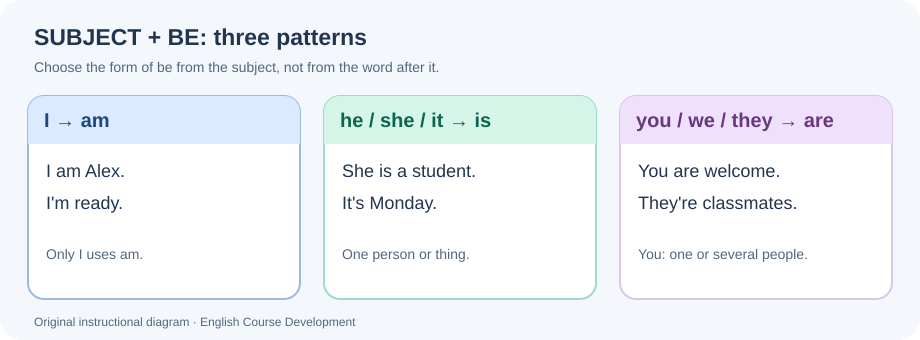

# Elementary 1A — Welcome to the class

**Lesson ID:** `elementary.unit_01.lesson_a` · **A1 orientation (provisional)** · **Editorial draft — not approved**

This is an **original self-study lesson**, aligned with the topic sequence of *English File Elementary, Fourth Edition*. The book's index identifies **affirmative _be_ + subject pronouns**, **days of the week**, **numbers 0–20**, and **vowel sounds / word stress** for 1A. The explanations, contexts, practice and diagram below are created for our program; they are **not** reproduced from the book.

!!! info "Your route through this lesson"
    **Grammar (four short steps with checks) → Vocabulary → Everyday English → Practice → Guided/Controlled/Independent Writing → Tutor activities → Quick reference.** Listening, Speaking and Pronunciation practice takes place interactively with English Learning Program; the public exercises below are **ungraded**.

## 1. Learning outcomes

By the end, you should be able to:

1. **Identify** the subject of a simple statement and choose the correct affirmative form of *be*: **am, is, are**.
2. **Produce** meaningful affirmative sentences about names, people, roles, places and simple states, using all seven subject pronouns.
3. **Recognize and use** the standard contractions **I'm, you're, he's, she's, it's, we're, they're**.
4. **Use** the seven days of the week and numbers **zero to twenty** in familiar contexts.
5. **Write** a short introduction of yourself and another person, with appropriate capitalization and punctuation.
6. **Practise** understanding and producing short introductions, number sequences and word stress with the interactive tutor.

**Before you begin:** you only need to recognize the Latin alphabet and a few familiar English words. No earlier grammar lesson is required. **Next:** 1B develops negatives and questions with *be*; these are deliberately **not** the main grammar of 1A.

## 2. Grammar learning path

Work through these four steps in order. Each step has a **short example** and a **check** before you continue. The longer ungraded practice is in section 6.

### Step 1 — Understand the subject

#### Core idea / Concepto clave: subject pronouns

**English:** The **subject** tells us who or what a sentence is about. A **subject pronoun** can replace a name or group of names. In a normal English statement, the subject comes before the verb.

**Español:** El **sujeto** indica de quién o de qué hablamos. Un **pronombre sujeto** puede reemplazar un nombre y normalmente aparece antes del verbo. En inglés no solemos omitirlo, aunque en español sí: *Soy estudiante* → **I am a student**.

#### Examples — seven pronouns in context

| Pronoun | Spanish guide | Short affirmative example |
|---|---|---|
| **I** | yo | **I** am Ana. |
| **you** | tú / usted / ustedes / vosotros | **You** are here. |
| **he** | él | **He** is a student. |
| **she** | ella | **She** is ready. |
| **it** | eso / ello; a thing or a situation | **It** is Monday. |
| **we** | nosotros / nosotras | **We** are classmates. |
| **they** | ellos / ellas; sometimes one person | **They** are in class. |

Read the subject, then ask: **Who or what is the sentence about?** For example, *Leo is a student* → *He is a student* when **he** is the appropriate pronoun. *Leo and Ana are here* → *They are here*. *Leo and I are here* → *We are here* because **I** is part of the group.

!!! tip "Three details worth knowing"
    - **I** is always capitalized: *Ana and I are here.*
    - **You** can mean one person or several; it will take **are** in this lesson.
    - **It** normally refers to things and impersonal situations (*It's Monday*). Use a person's appropriate pronoun. **They** can also refer to one person of unknown gender or a person who uses *they*; its verb is still **are**.

#### Check your understanding

**A.** Replace *Marta and I* with one pronoun.  
**B.** Which pronoun fits *the notebook*?  
**C.** What is the subject in *They are classmates*?

??? note "Check — Step 1"

    **A. We** — the speaker is included.  
    **B. It** — a notebook is a thing.  
    **C. They** — the subject is before *are*.

**Continue when:** you can name all seven pronouns and identify the subject in an example.

### Step 2 — Understand how *be* works

#### Core idea / Concepto clave: affirmative *be*

**English:** We use **be** to identify someone or something, describe a state or say where someone is. In the present affirmative, **be changes with the subject**: *am*, *is* or *are*.

**Español:** **Be** puede expresar **ser** o **estar**. Su forma depende del sujeto, no de la palabra que viene después: **I am**, **he/she/it is**, **you/we/they are**.

#### Examples — choose the form

*Teaching note:* First find the subject. Then select its matching form of *be*. The diagram and the following table convey the same rule.

| Subject | Form of *be* | Complete example |
|---|---|---|
| I | **am** | I am in class. |
| he / she / it | **is** | She is a teacher. |
| you / we / they | **are** | We are ready. |

**Why three forms?** *Be* is **irregular**. You do not create its form by adding a normal ending to one basic word. Learn the three meaningful groups: **I → am**, **he/she/it → is**, **you/we/they → are**.

Compare: **He is ready.** / **They are ready.** The word *ready* is unchanged; the **subject** controls the verb. The same happens with **You are ready** whether *you* refers to one person or a group.

#### How to build an affirmative sentence

**Pattern:** **subject + am/is/are + information + .**

- **I + am + a student.** → *I am a student.*
- **She + is + in Room 2.** → *She is in Room 2.*
- **We + are + happy.** → *We are happy.*

Put **the subject first**, add **its form of be**, then add the information. This is not the usual pattern for a question; questions are taught in **1B**.

#### Check your understanding

Choose the correct form and explain your choice.

**A.** *She ___ happy.*  
**B.** *You ___ a student.* (one person)  
**C.** *The notebooks ___ here.*

??? note "Check — Step 2"

    **A. is** — *she* belongs to the **is** group.  
    **B. are** — *you* always takes **are**, even for one person.  
    **C. are** — *the notebooks* means several things, like *they*.

**Continue when:** you can explain **why** the subject selects *am*, *is* or *are* without looking at the table.

### Step 3 — Add useful information after *be*

An affirmative statement becomes meaningful when we add information after the verb. These patterns introduce different meanings **without changing the subject–verb rule**.

| Purpose | Pattern | Example | Spanish |
|---|---|---|---|
| Name / identity | subject + *be* + name | I'm Sofia. | Soy Sofía. |
| Job / role | subject + *be* + **a/an** + job | He is an engineer. | Él es ingeniero. |
| State / description | subject + *be* + adjective | They are tired. | Están cansados. |
| Place | subject + *be* + place phrase | We are in class. | Estamos en clase. |
| Day | *it* + *be* + day | It is Thursday. | Es jueves. |

#### Understand two small details

**1. Jobs and *a/an*.** An English singular job normally needs an article: **She is a teacher**, not *She is teacher*. Use **an** before a vowel **sound**: *He is an engineer*. This is a useful introductory pattern; the full lesson on articles comes later.

**2. Descriptions don't agree in number.** **She is happy** and **They are happy** use the same adjective. Don't add *-s* to *happy* for the plural.

**Technology in context — optional program extension:** *I am a data engineer.* / *It is a laptop.* / *We are in a video call.* These illustrate the same everyday grammar and do not require technical knowledge.

#### Check your understanding

**A.** Choose the correct sentence: *She is teacher* / *She is a teacher*.  
**B.** Explain what changes: *He is happy* → *They are happy*.  
**C.** Complete: *It ___ Friday.*

??? note "Check — Step 3"

    **A. She is a teacher** — a singular job needs **a** here.  
    **B. is → are** — the subject changes from *he* to *they*, but *happy* stays the same.  
    **C. is** — a day is expressed with *it is*.

**Continue when:** you can make one sentence about a person and one about a place.

### Step 4 — Make English natural: contractions

#### Core idea / Concepto clave: contractions

**English:** A **contraction** is a shorter written and spoken form. The apostrophe (') shows that letters have been omitted. In everyday introductions, contractions often sound more natural.

**Español:** Una **contracción** une palabras y reemplaza letras por un apóstrofo: **I am → I'm**. No cambia el significado de la afirmación.

#### Examples — full and short forms

| Full form | Contraction | Original context |
|---|---|---|
| I am | **I'm** | I'm Elena. |
| You are | **You're** | You're early. |
| He is | **He's** | He's a student. |
| She is | **She's** | She's here. |
| It is | **It's** | It's Tuesday. |
| We are | **We're** | We're classmates. |
| They are | **They're** | They're ready. |

**I am ready** and **I'm ready** express the same basic idea. The full form can sound deliberate or emphatic; the contraction is common in conversation and informal writing.

!!! note "Avoid a common Spanish-speaker confusion"
    **You're** means *you are*. **Your** is a different word, introduced formally in **1C**.  
    **It's** means *it is*. **Its** is also a different word; do not confuse the apostrophe with possession.

#### The five common traps

| Not this | Say this | Reason |
|---|---|---|
| *Am a student.* | **I am a student.** | Normal statements need a subject. |
| *He are ready.* | **He is ready.** | **He** selects **is**. |
| *You is early.* | **You are early.** | **You** selects **are** even for one person. |
| *She is teacher.* | **She is a teacher.** | The singular job needs **a**. |
| *Is Monday.* | **It is Monday.** | The day needs **it** here. |

#### Check your understanding

**A.** Expand *We're here* into its full form.  
**B.** Shorten *She is ready*.  
**C.** Correct *You is in class*.

??? note "Check — Step 4"

    **A. We are here.**  
    **B. She's ready.**  
    **C. You are in class.** In each case the subject still determines the verb.

**Continue when:** you can use the full form and contraction without confusing *you're* with *your*.

!!! info "What comes next?"
    **1B:** negatives and questions with *be*. **1C:** possessive adjectives. You can recognize fixed expressions that contain later structures, but you do **not** need to produce those grammar patterns in 1A.

## 4. Vocabulary — days of the week

### 4.1 All seven days

| Day | Spanish | Beginner example |
|---|---|---|
| Monday | lunes | It's Monday. |
| Tuesday | martes | It's Tuesday. |
| Wednesday | miércoles | It's Wednesday. |
| Thursday | jueves | It's Thursday. |
| Friday | viernes | It's Friday. |
| Saturday | sábado | It's Saturday. |
| Sunday | domingo | It's Sunday. |

**English convention:** Capitalize all days, even in the middle of a sentence: *Our class is on Friday.*

**In context:**
- *Today is Monday.* (Today = hoy.)
- *Our English class is on Tuesday.* (**on** + a day; recognize this chunk for now.)
- *Saturday and Sunday are weekend days.*
- *Monday is day one in many calendars.* (Calendar numbering varies by country.)

!!! note "Two useful chunks"
    **on Monday** = el lunes; **on Mondays** = los lunes / cada lunes. The plural often suggests a recurring event. This contrast is for recognition only, not a full lesson about routines or Present Simple.

**Quick check:** What comes after **Wednesday**? Which is correct: *friday* or *Friday*?

??? note "Check the days"

    **Thursday** follows Wednesday. **Friday** starts with a capital letter because every day name is capitalized in English.

## 5. Vocabulary — numbers 0–20

| Number | Word | Number | Word | Number | Word |
|---:|---|---:|---|---:|---|
| 0 | zero | 7 | seven | 14 | fourteen |
| 1 | one | 8 | eight | 15 | fifteen |
| 2 | two | 9 | nine | 16 | sixteen |
| 3 | three | 10 | ten | 17 | seventeen |
| 4 | four | 11 | eleven | 18 | eighteen |
| 5 | five | 12 | twelve | 19 | nineteen |
| 6 | six | 13 | thirteen | 20 | twenty |

**Patterns to notice:**
- **eleven** and **twelve** are special forms.
- **thirteen to nineteen** end in *-teen*; pay attention to the spelling of **thirteen**, **fifteen** and **eighteen**.
- **twenty** is not *twoty*. The other tens (30, 40...) belong to **1B**, not this lesson.
- **Zero** is standard for mathematics and many technical contexts. In some informal contexts, English speakers say *oh* for the digit 0; this is an optional recognition note, not a new number.

**Original, contextualized examples:**
- *We are **two** students.*
- *Room **six** is ready.*
- *It is **seven** o'clock.* (Recognize this time phrase; formal time-telling comes later.)
- *The class is in Room **twelve**.*
- *The students are in Room **twenty**.*
- *The code is **one-zero-five**.* (Optional technology example: read the digits separately. Use a fictional code, not a real password or confidential number.)

**Quick check:** Write **12** and **18** in words. Which spelling is correct: *fiveteen* or *fifteen*?

??? note "Check the numbers"

    **Twelve**, **eighteen**, **fifteen**. Memorize the irregular spellings; numbers 21–100 are introduced later in 1B.

## 6. Everyday English — a first meeting

These are natural **fixed expressions** for recognition and simple use. Do not try to analyze every word with grammar you haven't studied yet.

| Situation | Useful expression | Spanish |
|---|---|---|
| Greeting | Hello. / Hi. | Hola. |
| Introducing yourself | I'm Emma. | Soy Emma. |
| Introducing a person | This is Leo. | Este es Leo. |
| Responding | Nice to meet you. | Mucho gusto. |
| Replying | Nice to meet you, too. | Igualmente. |
| Welcoming someone | Welcome to the class. | Bienvenido/a a clase. |
| Leaving | See you on Monday. | Nos vemos el lunes. |

**Mini-dialogue (original):**

> **A:** Hi. I'm Mila.  
> **B:** Hello, Mila. I'm Ben.  
> **A:** Nice to meet you.  
> **B:** Nice to meet you, too.  
> **A:** This is Ana. She's a student.  
> **B:** Welcome to the class, Ana.

*This is ...* is introduced as a useful **chunk**, not as a full lesson about demonstratives. Complex modal and phrasal-verb structures are deliberately deferred; familiar phrases are more useful at this stage.

## 7. Ungraded grammar practice — 20 original exercises

**Instructions:** Try the tasks **before** opening the answer panel. For 1–4, write only the missing verb. For 5–20, follow the instructions of each stage; use complete sentences, capitals and final punctuation whenever you rewrite a sentence. These activities are **ungraded self-study**, not formal English Learning Program assessments.

### Stage A — Recognize the form (1–4)

Choose **am**, **is** or **are**.

1. I ___ in Room 3.
2. He ___ a new student.
3. You ___ early today.
4. They ___ from Colombia.

### Stage B — Construct statements (5–10)

Use the words given to write **one correct affirmative sentence**. Use the full form of *be* first.

5. (she / a teacher)
6. (we / ready)
7. (it / Thursday)
8. (I / a beginner)
9. (you / in my group)
10. (Leo and Sara / classmates)

### Stage C — Fix a mistake (11–15)

Rewrite the **whole sentence** correctly. Each one contains **one** grammar mistake.

11. *He are at school.*
12. *Am a student.* (You are introducing yourself.)
13. *They is happy.*
14. *It are Wednesday.*
15. *She is a engineer.*

### Stage D — Use grammar in new contexts (16–20)

For **16–20**, read each new situation carefully. Each task combines at least two ideas from this lesson. **Do not use negatives or questions.** Follow the specific instruction for each item.

16. **A new student arrives.** Complete the two-sentence introduction with the correct **subject + full form of *be***: "Hello. ___ ___ Maya. I am a student." (You are Maya.)
17. **Two classmates are in Room 8.** Replace *Omar and Lina* with a pronoun and **rewrite the whole sentence using a contraction**: "Omar and Lina are in Room eight."
18. **A calendar notice.** Correct **all three** mistakes in this line and write the complete sentence: "*it are monday.*"
19. **A technology club introduction.** Arrange the words and choose **a/an**: *(engineer / an / is / Sofia)*. Write one complete sentence.
20. **A small group introduces itself.** Complete **both** statements using the correct form of *be*. Then contract the **second** statement: "I ___ Alex. Maya and I ___ students."

??? note "Answer key and explanations — open after attempting the exercises"

    | # | Expected answer | Why it works |
    |---:|---|---|
    | 1 | **am** | **I** takes **am**. |
    | 2 | **is** | **He** takes **is**. |
    | 3 | **are** | **You** takes **are**, even when one person is addressed. |
    | 4 | **are** | **They** takes **are**. |
    | 5 | **She is a teacher.** | **She + is**; the singular job has **a**. |
    | 6 | **We are ready.** | **We + are**; adjectives do not change for plural subjects. |
    | 7 | **It is Thursday.** | **It + is** for a day; capitalize the day. |
    | 8 | **I am a beginner.** | **I + am**, with **a** before the singular job/role noun. |
    | 9 | **You are in my group.** | **You + are**, followed by a place phrase. |
    | 10 | **Leo and Sara are classmates.** | Two people = a plural subject, so **are**. |
    | 11 | **He is at school.** | **He** cannot take **are** here. |
    | 12 | **I am a student.** | In a self-introduction, a subject (**I**) is required. |
    | 13 | **They are happy.** | The plural subject needs **are**. |
    | 14 | **It is Wednesday.** | **It + is**; **Wednesday** is a capitalized day. |
    | 15 | **She is an engineer.** | **An** comes before the vowel sound at the start of *engineer*. |
    | 16 | **I am Maya.** | The speaker introduces herself, so the subject is **I** and its full form is **am**. |
    | 17 | **They're in Room eight.** | The two named people become **they**; **they are → they're**. |
    | 18 | **It is Monday.** | Correct the initial lowercase **it**, replace **are** with **is**, and capitalize **Monday**. |
    | 19 | **Sofia is an engineer.** | Name first, then **is**; **an** goes before *engineer*. |
    | 20 | **I am Alex. We're students.** | **I → am**; **Maya and I → we → are → we're**. |

    **Accepted alternatives and task boundaries:** In 5–9, contractions (for example, *She's a teacher*) are natural, but the **full form is requested** for construction practice. In 10, *They're classmates* is grammatically possible but does not follow the instruction to use the given words. In 16, *I'm Maya* is a natural sentence, but the prompt requests the full form. In 17, *They are in Room eight* is correct English but does not satisfy the **contraction** instruction. In 18, **It's Monday** is also correct: it fixes the verb agreement and capitalization through a natural contraction. The full form demonstrates the rule more explicitly. In 19, *Sofia's an engineer* is natural but the prompt asks you to arrange the **given words**. In 20, *I am Alex. We are students* is correct English, but the second sentence must be contracted.

    **Reflect:** Did your error concern (1) the subject, (2) **am/is/are**, (3) a contraction, (4) word order, (5) **a/an**, or (6) capitalization? Write one fresh example to practise that specific point.

## 8. Vocabulary practice — ungraded

These do **not** count toward the 20 grammar exercises.

**A. Days in order:** Write the missing day.

- Monday, Tuesday, ___, Thursday.
- Friday, ___, Sunday.
- Sunday, ___, Tuesday.

**B. Numbers:** Write the number in words.

- 0 → ___
- 8 → ___
- 12 → ___
- 15 → ___
- 18 → ___
- 20 → ___

**C. Mini-classroom note:** Complete with a suitable day or number: *Our lesson is on ___. Room ___ is ready.* Many combinations are acceptable; choose one you can explain.

??? note "Vocabulary answers and accepted alternatives"

    **A:** Wednesday; Saturday; Monday (the week cycles from Sunday to Monday).  
    **B:** zero; eight; twelve; fifteen; eighteen; twenty.  
    **C:** Example: *Our lesson is on Wednesday. Room seven is ready.* Any correctly spelled day and any number appropriate to the context are valid; use a capital letter for the day.

## 9. Writing — from support to independence

Writing is a **separate skill** and these tasks are **not graded assessments**. Follow the three stages in order: first complete, then adapt, then create. You only need the vocabulary and affirmative grammar already introduced.

### Stage 1 — Guided writing (complete)

**Understand:** The subject goes first, then the correct form of *be*.

**Example:** *I ___ in class.* → **I am in class.**

Complete each line with **am**, **is** or **are**.

- **A.** I ___ a student.
- **B.** She ___ ready.
- **C.** We ___ classmates.

??? note "Check Stage 1"

    **A. am** (**I**); **B. is** (**she**); **C. are** (**we**). Keep the capital letter and period.

**Continue when:** you can select the form without looking at a table.

### Stage 2 — Controlled writing (adapt)

**Understand:** Change information in a model, keeping the pattern correct.

**Example:** *He is a student.* → change *he* to *they* → **They are students.** The subject, verb and plural noun change together.

Now rewrite the entire sentence as requested:

- **A.** *She is a student.* → change **she** to **we**, and change the singular noun to a plural.
- **B.** *It is Monday.* → change the day to **Friday** and use a contraction.
- **C.** *They are ready.* → use the full form after changing **they** to **I**.

??? note "Check Stage 2"

    **A. We are students.** The subject is plural, so **are** and **students** fit.  
    **B. It's Friday.** **It is** becomes **it's**; capitalize the day.  
    **C. I am ready.** Changing the subject to **I** changes the verb to **am**.

**Continue when:** you can make the requested change without leaving the old verb behind.

### Stage 3 — Independent writing (create)

Write **four original affirmative sentences** about an imaginary class or a familiar everyday situation. Use **only** what you know:

1. Introduce yourself with *I am* or *I'm*.
2. Say something true or imaginary about a classmate using *he*, *she* or *they*.
3. Say something about a group with *we* or *they*.
4. Include a day of the week **or** a number between **0 and 20**.

**Original model (use different information):** *I'm Eli. She's a student. We are classmates. It's Tuesday.*

**Optional extension:** Create a short **six-line** dialogue between two classmates using greetings from section 6, at least two affirmative sentences with *be* and a day or number. Expressions like *Nice to meet you* are **fixed phrases for recognition and use**, not grammar you must analyse today.

??? note "Self-check and valid writing examples"

    Check all five points:
    
    1. Every statement has a subject.
    2. Each subject takes **am**, **is** or **are** correctly.
    3. **I** and the days of the week are capitalized.
    4. Singular job or role nouns take **a/an** when needed.
    5. Each sentence ends with a period; contractions contain an apostrophe.

    **Many different answers are correct.** One possible set: *I'm Sam. He is a student. We are in class. It's Thursday.* Names, days and numbers can vary. These are self-check examples, not official assessment answers.

## 10. Tutor handoff — Listening, Speaking and Pronunciation

This section is a **handoff for English Learning Program**, not a recorded or graded activity on this public page. Each activity has a concrete outcome, an accessible first step and a next step if comprehension improves.

### Listening — hear short introductions

**Outcome:** Identify a **name**, an affirmative *be* statement and a familiar **day or number** in a short spoken message.

**Tutor sequence:**

1. Read an original two-sentence message slowly, such as: *I'm Nina. It's Friday.* Do **not** display the transcript initially.
2. Ask the learner to say the name and day. Accept the information before correcting minor spelling.
3. Read two additional messages featuring **he/she/they** and numbers **0–20**. Use a little more natural speed only when meaning is clear.
4. If the learner struggles, **repeat → slow down → rephrase with familiar vocabulary → offer concise Spanish support**, then retry a new message.

### Speaking — introduce people

**Outcome:** Produce at least **three intelligible affirmative turns** with the correct subject–verb pairing.

**Tutor sequence:**

1. Model *I'm Nina. I'm a student.* The learner creates a new introduction.
2. Show or describe two imaginary classmates. The learner introduces them using **he**, **she** or **they** and **is/are**.
3. Ask for the same meaning with **one full form and one contraction**: *She is ready* → *She's ready*.
4. Practise the mini-dialogue expressions from section 6 as fixed chunks, without requiring questions or negatives.

### Pronunciation — vowels and word stress

**Outcome:** Make familiar short phrases understandable and notice **vowel contrasts** and **stressed syllables** without IPA memorization.

**Tutor sequence:**

1. Model two or three familiar words with simple contrasting vowels (for example, *sit* and *seat* as **listening-only** examples). Check whether the learner hears a difference; do not require technical phonetic labels.
2. Model the stress in *MONday*, *TUESday* and *STUdent*. Ask the learner to repeat naturally and identify which syllable sounds stronger.
3. Practise short affirmative sentences, such as *I'm READY* and *She's a STUdent*, paying attention to intelligibility, not accent imitation.
4. Start slow, then approach natural rhythm gradually. If speech recognition reports uncertainty, do not treat that alone as evidence of a pronunciation error.

**Across all three skills:** Use new utterances, not official test prompts. Give targeted feedback during **practice**; do not generate scores or pretend a formal assessment was completed. Private progress and assessment evidence belong only in English Learning Program.

## 11. Quick reference

| Remember | Pattern / examples |
|---|---|
| Subject pronouns | **I, you, he, she, it, we, they** |
| Three verb forms | **I am** · **he/she/it is** · **you/we/they are** |
| Common contractions | **I'm, you're, he's, she's, it's, we're, they're** |
| Sentence order | **subject + be + information** |
| Occupation | **She is a teacher.** / **He is an engineer.** |
| Day | **It's Friday.** / **on Monday** |
| Numbers | **zero, one, two, ... twenty** |
| Biggest traps | Missing subject; *you is*; *they is*; *a engineer*; lowercase day names |
| Scope | **Affirmative statements now**; negatives/questions in **1B**, possessive adjectives in **1C** |

**Review tomorrow:** Without looking at the table, say all seven subject pronouns, pair them with the right verb, name the days in order and count from zero to twenty. Revisit after a few days if recall is uncertain.

**Course navigation:** Return to the [Elementary overview](../index.md). **Next planned lesson:** Elementary 1B — *One world* (not published yet).

---

**Source and editorial note:** Unit 1A topic mapping was verified against the original private Elementary Fourth Edition index (`elementary_1.png`, contents page 2; asset SHA-256 recorded in `curriculum/master_syllabus.yaml`). All explanatory material, exercises, examples and the SVG diagram are original program content. This page is a **pilot draft awaiting approval**, not an Oxford reproduction or formal CEFR assessment.
