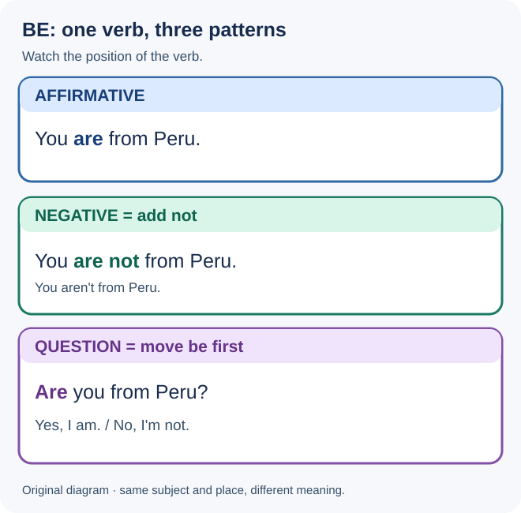

# Elementary 1B — One world

**Elementary · Unit 1B** · **A1 learning orientation**

This is an **original self-study lesson** based on the *topics* of English File Elementary, Fourth Edition, Unit 1B: **negative statements and questions with be**, **countries**, **numbers 21–100**, and **consonant sounds / word stress**. All explanations, dialogues, examples, answers, and visuals here are original program materials, not copies of the textbook.

!!! info "Your study route"
    **Grammar in four steps (understand → examples → check → continue) → Vocabulary → Everyday English → 20 ungraded exercises → Writing in three stages → Oral tutor handoff → Quick reference.** Pause between blocks. Listening, Speaking and Pronunciation are practised with English Learning Program.

## 1. Your goals and starting point

After this lesson, you should be able to:

1. **Make negative statements** using *am not*, *is not* and *are not* with suitable subjects.
2. **Form and answer simple yes/no questions** by placing *am/is/are* before the subject.
3. **Ask and answer where people are from** using *Where + be + subject + from?*
4. **Use country names** to describe origins without confusing a country with a nationality word.
5. **Read, spell and use numbers 21–100**, especially tens and compound numbers.
6. **Write** a brief original question-and-answer dialogue and **practise** recognizing and producing these forms in spoken English.

**Prerequisite:** Review [Elementary 1A — Welcome to the class](lesson_a.md). You need the seven subject pronouns and affirmative *am/is/are*, plus numbers 0–20. If those feel uncertain, revisit the 1A diagram and answer key before starting.

**What stays outside 1B:** Formal teaching of **possessive adjectives** (*my, your, his...*) belongs to **1C**. We will not teach the Present Simple with *do/does* here. This lesson's questions use **be**.

## 2. Grammar learning path

### Step 1 — Make negative statements with *be*

#### Understand / Comprender

**English:** An affirmative sentence **states something**; a negative sentence **says it is not the case**. With present-tense *be*, put **not directly after am/is/are**. Both types can describe real or imagined situations.

**Español:** Para negar una oración con *be*, añadimos **not después del verbo**. La forma de *be* sigue dependiendo del sujeto: *I am not*, *she is not*, *we are not*.

#### Examples

| Affirmative (1A) | Negative (1B) | Reason |
|---|---|---|
| I **am** in Room 2. | I **am not** in Room 2. | *not* after **am** |
| She **is** from Brazil. | She **is not** from Brazil. | *not* after **is** |
| It **is** Friday. | It **is not** Friday. | *not* after **is** |
| You **are** late. | You **are not** late. | *not* after **are** |
| We **are** teachers. | We **are not** teachers. | *not* after **are** |
| They **are** here. | They **are not** here. | *not* after **are** |

**Pattern:** **subject + am/is/are + not + information + .**

Think in three decisions: **Who is the subject? → Which form of be? → Add not.**

Compare *She is from Brazil* with *She is not from Brazil*. The country and subject do not change; the meaning changes because of **not**. The information can be about identity, a location or a state, just as in 1A.

#### Check your understanding

**A.** Complete: *I ___ not from Canada.*  
**B.** Correct: *He not is a student.*  
**C.** Make negative: *They are in Room 5.*

??? note "Check — Step 1"

    **A. am** — *I* selects **am**.  
    **B. He is not a student.** — **not** follows **is**, not the subject.  
    **C. They are not in Room 5.** — add **not** after **are**.

**Continue when:** you can make a negative without changing the affirmative subject–verb agreement.

### Step 2 — Understand natural negative contractions

#### Understand / Comprender

**English:** In conversation, a negative statement often uses a contraction. You can shorten **be + not** (*she isn't*, *they aren't*) or shorten **subject + be**, leaving *not* separate (*she's not*, *they're not*). The meaning stays the same in these examples; the choice is usually about natural speech rather than a change in grammar.

**Español:** Las contracciones negativas son naturales al hablar. *She isn't* y *She's not* significan lo mismo en estos ejemplos. Con *I*, usamos **I'm not**, no *I amn't* en el inglés estándar que estudiamos aquí.

#### Examples

| Full form | Natural contraction | Also natural |
|---|---|---|
| I am not | **I'm not** | — |
| You are not | **You aren't** | **You're not** |
| He is not | **He isn't** | **He's not** |
| She is not | **She isn't** | **She's not** |
| It is not | **It isn't** | **It's not** |
| We are not | **We aren't** | **We're not** |
| They are not | **They aren't** | **They're not** |

- **He isn't from Peru.** = **He's not from Peru.** Both are correct.
- **We're not late.** = **We aren't late.** Both are correct.
- **I'm not an engineer.** The everyday standard form uses **I'm not**.

!!! warning "A common mistake"
    Do not write *I amn't* or *I isn't*. Use **I'm not**. Also, **isn't** needs an apostrophe: *isnt* is a spelling mistake.

#### Check your understanding

**A.** Contract *She is not ready* in **two ways**.  
**B.** Contract *I am not from Spain*.  
**C.** Which is correct: *They isn't here* or *They aren't here*?

??? note "Check — Step 2"

    **A. She isn't ready. / She's not ready.** Both are acceptable.  
    **B. I'm not from Spain.** There is no standard **amn't** contraction in this lesson.  
    **C. They aren't here.** *They* requires **are**, not **is**.

**Continue when:** you can recognize both common contraction patterns without assuming there is only one correct option.

### Step 3 — Make yes/no questions and short answers

#### Understand / Comprender

**English:** To ask a **yes/no question** with *be*, move **am/is/are before the subject**. Do **not** add *do* or *does* to these questions. A short answer usually repeats the right form of *be*.

**Español:** En las preguntas con *be*, el verbo va **antes del sujeto**: *You are ready* → **Are you ready?**. En respuestas cortas, repetimos *be*: **Yes, I am. / No, I'm not.**

#### Examples — the same information, three patterns

*Teaching note:* The diagram keeps the subject and country the same to isolate the change in word order and meaning.

| Statement | Question | Short answer |
|---|---|---|
| You are from Peru. | **Are you** from Peru? | Yes, I am. / No, I'm not. |
| He is in class. | **Is he** in class? | Yes, he is. / No, he isn't. |
| She is from Italy. | **Is she** from Italy? | Yes, she is. / No, she isn't. |
| It is Tuesday. | **Is it** Tuesday? | Yes, it is. / No, it isn't. |
| We are early. | **Are we** early? | Yes, we are. / No, we aren't. |
| They are students. | **Are they** students? | Yes, they are. / No, they aren't. |

**Question pattern:** **Am/Is/Are + subject + information + ?**

**Answer pattern:** **Yes, + subject + am/is/are.** / **No, + subject + am not/isn't/aren't.**

Why does *Are you…?* have the answer *Yes, I am*? **You** is the person being asked; **I** is the person answering. The speaker changes.

!!! tip "Short positive answers"
    Use **Yes, she is** rather than *Yes, she's*. In standard short affirmative answers, the final verb is **not contracted**. Negative short answers can use contractions: **No, she isn't** / **No, she's not**.

**A question with I:** *Am I in the right room?* → *Yes, you are.* This is grammatically possible but less useful for a first meeting. Learn the more common *Are you…?*, *Is she…?* and *Are they…?* patterns first.

#### Check your understanding

**A.** Make a question: *You are from Colombia.*  
**B.** Give a positive short answer: *Is Leo a student?* (Yes.)  
**C.** Answer from your own point of view: *Are you ready?* (No.)

??? note "Check — Step 3"

    **A. Are you from Colombia?** — move **are** before **you**.  
    **B. Yes, he is.** — *Leo* becomes **he** (when that is his pronoun); do not end with *he's*.  
    **C. No, I'm not.** — the respondent uses **I**, not **you**.

**Continue when:** you can turn a statement into a question and produce an answer that matches the person responding.

### Step 4 — Ask where someone is from

#### Understand / Comprender

**English:** **Where ... from?** asks about a person's place of origin. Put **where** first, then the correct form of **be**, then the subject. This is a *wh-* question, so the answer normally gives information, not just *yes* or *no*.

**Español:** **Where are you from?** significa **¿De dónde eres?**. Su estructura es **Where + be + sujeto + from?**, y normalmente respondemos con un lugar: **I'm from Colombia.**

#### Examples

| Question | Natural response |
|---|---|
| **Where are you from?** | I'm from Colombia. |
| **Where is Mia from?** | She's from Canada. |
| **Where are Ana and Leo from?** | They're from Mexico. |
| **Where is this company from?** | It's from Japan. |

**Pattern:** **Where + am/is/are + subject + from + ?**

- **Where are you from?** = *Where + are + you + from?*
- **Where is Leo from?** = *Where + is + Leo + from?*

You **cannot** use affirmative order after *where*: *Where you are from?* is not the standard direct-question pattern taught here.

**Country versus nationality:** *I'm from Brazil* uses a **country name**. *I'm Brazilian* uses a **nationality adjective**. The second pattern is useful to recognize, but today's vocabulary focus is **countries**; do not memorize nationality forms as a new required set.

#### Check your understanding

**A.** Put in order: *you / from / where / are?*  
**B.** Complete: *Where ___ Sara from?*  
**C.** Answer with a full sentence: *Where are you from?* (Use a country of your choice.)

??? note "Check — Step 4"

    **A. Where are you from?** — the verb **are** comes before **you**.  
    **B. is** — *Sara* is one person; use **is**.  
    **C. I'm from Colombia.** is one possible answer; **I'm from Mexico / Peru / Canada / Japan**, etc., are also valid if the country fits your chosen context.

**Continue when:** you can ask and answer about origin without adding a second auxiliary verb.

!!! success "Study pause 1 — consolidate"
    Close your notes and say three forms aloud: **I'm from…**, **I'm not from…**, **Are you from…?**. Explain the word-order difference in your own words. Review a single step if needed before moving to Vocabulary.

## 3. Vocabulary — countries

### Country names in useful contexts

All country names begin with **capital letters** in English. Use **from + country** to describe origin.

| Country | Español | Original sentence |
|---|---|---|
| Colombia | Colombia | I'm from Colombia. |
| Mexico | México | She's from Mexico. |
| Brazil | Brasil | He's from Brazil. |
| Peru | Perú | They aren't from Peru. |
| Argentina | Argentina | Is she from Argentina? |
| Chile | Chile | We're from Chile. |
| Canada | Canadá | Are you from Canada? |
| the United States / the US | Estados Unidos / EE. UU. | He's from the United States. |
| the United Kingdom / the UK | Reino Unido | Is she from the UK? |
| Spain | España | I'm not from Spain. |
| France | Francia | Are they from France? |
| Italy | Italia | Is he from Italy? |
| Germany | Alemania | She's from Germany. |
| Japan | Japón | They're from Japan. |
| China | China | Is it from China? |

This is a **selected beginner practice list**, not a claim that the original book teaches precisely these fifteen countries.

**Useful observations:**

- Use **the** with **the United States**, **the US**, **the United Kingdom** and **the UK**, but usually not with *Colombia, Brazil* or *Japan*.
- **From** introduces origin: *I'm from Mexico*. For the question, move *be*: *Are you from Mexico?*
- Country names are different from nationality adjectives: *Spain* and *Spanish* are not interchangeable after *from*.

**Everyday application:**

> **A:** Are you from Canada?  
> **B:** No, I'm not. I'm from Mexico.  
> **A:** Is Sofia from Mexico, too?  
> **B:** Yes, she is.

These are invented fictional speakers. Never assume someone's origin from their name.

**Check:** Correct *he is from brazil* and answer *Is he from Brazil?* (Yes.)

??? note "Countries — answer"

    **He is from Brazil.** Capitalize **He** and **Brazil**.  
    **Yes, he is.** — affirmative short answers normally use the full verb.

## 4. Vocabulary — numbers 21–100

### 4.1 The tens

| Number | Word | Number | Word |
|---:|---|---:|---|
| 20 | twenty (1A review) | 60 | sixty |
| 30 | thirty | 70 | seventy |
| 40 | forty | 80 | eighty |
| 50 | fifty | 90 | ninety |
| 100 | one hundred | — | — |

**Watch the spelling:** **forty** (not *fourty*), **fifty** (not *fivety*), **eighty** (not *eightty*).

**One hundred** and **a hundred** are both natural ways to express 100: *one hundred students* / *a hundred students*. Avoid an unnecessary plural *hundreds* in *one hundred*.

### 4.2 Build numbers between tens

For most numbers between 21 and 99, combine **tens + units** with a hyphen in standard written English.

| Number | Written form | Number | Written form |
|---:|---|---:|---|
| 21 | twenty-one | 34 | thirty-four |
| 42 | forty-two | 56 | fifty-six |
| 67 | sixty-seven | 78 | seventy-eight |
| 83 | eighty-three | 99 | ninety-nine |

**Why the hyphen?** It helps show that the two words form **one compound number**: *twenty-one*. Do not write *twenty one* as the standard form in a carefully written exercise.

**Numbers 13–19 versus 30–90:** *thirteen* (13) and *thirty* (30) are different. Listen for their stress and ending. We revisit the contrast in the tutor session.

**Real-life examples (original):**
- *Room twenty-four is ready.*
- *There are sixty students in the hall.* (Useful fixed example; **there are** is not a grammar target today.)
- *The classroom number is forty-two.*
- *The meeting is in Room eighty-one.* (Optional workplace context; no technical knowledge required.)

### 4.3 A note about reading digits

When reading an identification number or a room code, speakers may read **digits separately**: *Room 48* is normally *Room forty-eight*, but a fictional code **4-8** can be read *four-eight*. Never share real access codes or passwords in an exercise.

**Quick check:** Write 40, 58 and 100 in words.

??? note "Numbers — answer"

    **40: forty**; **58: fifty-eight**; **100: one hundred** (also **a hundred** in many contexts).

!!! success "Study pause 2 — vocabulary recall"
    Without looking, name five countries, spell **thirty, forty, fifty**, and write **twenty-seven** and **ninety-two** in digits. Take a break before the exercises if useful.

## 5. Everyday English — polite, simple exchanges

You already know *Hello*, *I'm…* and *Nice to meet you* from 1A. These useful expressions connect naturally to 1B.

| Function | Useful expression | Note |
|---|---|---|
| Checking understanding | Sorry? | Polite request to repeat; fixed chunk |
| Asking origin | Where are you from? | 1B question pattern |
| Giving origin | I'm from Chile. | Affirmative review |
| Clarifying | No, I'm not. | Negative short answer |
| Confirming | Yes, I am. | Positive short answer |
| Ending politely | Nice to meet you, too. | Fixed everyday phrase |

**Mini-dialogue (original):**

> **Lena:** Hi. I'm Lena. Are you from Japan?  
> **Noah:** No, I'm not. I'm from France.  
> **Lena:** Sorry? France?  
> **Noah:** Yes. I'm from France.  
> **Lena:** Nice to meet you, Noah.  
> **Noah:** Nice to meet you, too.

**Register:** *Sorry?* is informal but polite in many everyday conversations. *Could you repeat that, please?* is a useful polite chunk to **recognize**, not a modal construction to analyze or produce as new grammar in 1B.

## 6. Ungraded grammar practice — 20 original exercises

**Instructions:** Complete these **before opening the answer panel**. For 1–4, supply the missing negative form; for 5–20 follow each stage's instructions. When rewriting sentences, capitalize the first word and use the correct final punctuation. These are **self-study questions**, not official assessments.

### Stage A — Recognize negatives (1–4)

Complete with the correct **full negative form**: *am not, is not, are not*.

1. I ___ from Spain.
2. She ___ a teacher.
3. They ___ ready.
4. You ___ in Room 30.

### Stage B — Build questions (5–8)

Rewrite each statement as a **yes/no question** with *be*. Keep the original subject and information.

5. You are from Argentina.
6. He is in Room 50.
7. They are students.
8. It is Tuesday.

### Stage C — Choose short answers and contractions (9–12)

Write the **short answer requested**. Use the subject from the question correctly.

9. *Are you from Canada?* (Yes — answer as the person being asked.)
10. *Is Nora from Italy?* (No — use **she** and **isn't**.)
11. *Are Leo and Ava classmates?* (Yes — replace the names with a pronoun.)
12. *Is the laptop from Japan?* (No — use **it's not**.)

### Stage D — Repair an error (13–16)

Each sentence contains **one main grammar error** (capitalization and punctuation are otherwise correct). Rewrite it correctly.

13. *I isn't from Brazil.*
14. *Where you are from?*
15. *Is they from Chile?*
16. *Yes, she's.* (This is a complete short answer to *Is Mia here?*)

### Stage E — Apply the grammar in context (17–20)

17. **A first meeting:** Imagine your name is Cam and you are from Peru. Complete both lines using correct question order and a natural negative short answer (write **two words** after *No*):  
    **A:** "___ you from Mexico?"  
    **B (Cam):** "No, ___ ___. I'm from Peru."
18. **A classroom register:** Join these ideas into **two complete sentences**. First make a negative statement, then ask a question: *(Lara / not / from Germany)*; *(she / from France?)*.
19. **Country and number:** Correct **every error** in this short notice. Treat **Room forty-two** as an official classroom label (like *Room 42*): *"are they from colombia? yes, they're. They are in room fourty-two."*
20. **A technology club:** Write a **two-line original dialogue** in which one person asks whether a fictional device is from Japan and another answers negatively, then gives a different country of origin. Use *it*, and one natural negative contraction.

??? note "Grammar answers — explain before memorizing"

    | # | Expected answer | Why |
    |---:|---|---|
    | 1 | **am not** | **I** takes *am*; put *not* after it. |
    | 2 | **is not** | **She** takes *is*, then *not*. |
    | 3 | **are not** | **They** takes *are*, then *not*. |
    | 4 | **are not** | **You** takes *are* even for one person. |
    | 5 | **Are you from Argentina?** | Move *are* before *you*. |
    | 6 | **Is he in Room 50?** | Move *is* before *he*. |
    | 7 | **Are they students?** | Move *are* before *they*. |
    | 8 | **Is it Tuesday?** | Move *is* before *it*. |
    | 9 | **Yes, I am.** | The person addressed as *you* answers as *I*. |
    | 10 | **No, she isn't.** | **Nora → she**, and *isn't* is a valid negative. |
    | 11 | **Yes, they are.** | Two people become **they**; do not contract final affirmative *are*. |
    | 12 | **No, it's not.** | **The laptop → it**; *it's not* is a natural negative form. |
    | 13 | **I'm not from Brazil.** | *I* cannot take *isn't*. **I am not from Brazil** also works. |
    | 14 | **Where are you from?** | In a direct question, *are* comes before *you*. |
    | 15 | **Are they from Chile?** | The plural subject *they* needs *are*. |
    | 16 | **Yes, she is.** | Do not end a complete positive short answer with *she's*. |
    | 17 | **Are; I'm not.** | The question begins **Are you…?**; Cam answers about himself using **I** and the two-word negative contraction **I'm not**. |
    | 18 | **Lara isn't from Germany. Is she from France?** | Negative: *isn't*. Question: *is* before *she*. |
    | 19 | **Are they from Colombia? Yes, they are. They are in Room forty-two.** | Fix **are → Are** and **colombia → Colombia**. Replace **Yes, they're** with **Yes, they are** because positive short answers do not end with a contraction. Capitalize the named **Room** label and correct **fourty-two → forty-two** (spelling plus hyphen). |
    | 20 | **A: Is it from Japan? B: No, it isn't. It's from Canada.** | Use *Is it…?*, a contracted negative answer and an affirmative statement. |

    **Valid alternatives:** 10 may be **No, she's not** in natural English, although the prompt specifically requests **isn't**. In 12 **No, it isn't** is grammatical but does not follow the requested *it's not* pattern. In 13 **I am not from Brazil** is also correct. In 18 **Lara is not from Germany** / **Lara's not from Germany** work. *Is Lara from France?* is correct English and expresses the same idea, but the supplied cue **she / from France?** asks you to practise the pronoun **she**. In 19 **They're in Room forty-two** is acceptable for the last sentence if the meaning is retained. In 20 any different country is acceptable, and **No, it's not** is a valid negative answer. A complete answer with *No, it is not* is grammatical but does not meet the contraction instruction.

    **Self-diagnosis:** When you make a mistake, label it *agreement*, *not position*, *question order*, *speaker change*, *short-answer form*, *country capitalization*, or *number spelling*. Rewrite one new sentence to correct the pattern.

## 7. Vocabulary practice — ungraded

**A. Country selection:** Complete with the country indicated in Spanish: *(México)* / *(Alemania)* / *(Japón)*.
- I'm from ___.
- She isn't from ___.
- Are they from ___?

**B. Numbers:** Write the following in English: 21, 35, 40, 58, 73, 86, 99, 100.

**C. Your own choice:** Write an original negative statement with one country, followed by a question about another country. Use the correct country capitals.

??? note "Vocabulary answers and possible choices"

    **A:** *Mexico*, *Germany*, *Japan*, respectively.  
    **B:** *twenty-one*, *thirty-five*, *forty*, *fifty-eight*, *seventy-three*, *eighty-six*, *ninety-nine*, *one hundred* (also *a hundred*).  
    **C:** Many answers work. Example: *I'm not from Japan. Are you from Spain?* Countries may vary; keep the negative and question patterns correct.

!!! success "Study pause 3 — from practice to production"
    Review your main errors, then leave Writing for another study block if you prefer. There is no requirement to finish the whole page in one sitting.

## 8. Writing — guided, controlled and independent

Writing is **ungraded self-study**. Use the same three stages that helped in 1A, but now practise negative statements and questions.

### Stage 1 — Guided writing (complete)

**Understand:** Add *not* after *be*; move *be* before the subject for questions.

**Example:** *She ___ not from Spain.* → **She is not from Spain.**

Complete each line:

- **A.** We ___ not from France.
- **B.** ___ you from Canada?
- **C.** ___ Mia from Germany?

??? note "Guided writing — answers"

    **A. are**; **B. Are**; **C. Is**. A plural subject takes *are*; questions put the verb first.

### Stage 2 — Controlled writing (adapt)

Rewrite the whole sentence following the instruction.

- **A.** *He is from Brazil.* → make it **negative** and use a contraction.
- **B.** *They are from Italy.* → make it a **yes/no question**.
- **C.** *Is Eva from Chile?* → write a **negative short answer** using *she*.

??? note "Controlled writing — answers and alternatives"

    **A. He isn't from Brazil.** / **He's not from Brazil.** Both are natural.  
    **B. Are they from Italy?** Move *are* before *they*.  
    **C. No, she isn't.** / **No, she's not.** Both use the correct subject and negative verb.

### Stage 3 — Independent writing (create)

Write an **original four-line dialogue** between two fictional new classmates. Include:

1. A greeting and one person's name (a fixed greeting from 1A is fine).
2. **Where are you from?**
3. An answer naming a country.
4. One **yes/no question** about a different country followed by a suitable **short answer**. You can fit the question and answer on one line if you use speaker labels.

**Original model (choose different names and countries):**

> **A:** Hello. I'm Iris.  
> **B:** Hi, Iris. Where are you from?  
> **A:** I'm from Peru. Are you from Brazil?  
> **B:** No, I'm not. I'm from Chile.

**Optional extension:** Write a short classroom notice using a country and a number 21–100, then add one question about it. Use known grammar and vocabulary only.

??? note "Independent writing — self-check"

    - Are names and country names capitalized?
    - Are **am/is/are** matched to the right subjects?
    - Is **not** directly after *be* (or included in a contraction)?
    - In a yes/no question, does *be* come **before the subject**?
    - Does a short answer match the person being addressed?
    - Do question marks appear after questions?
    - Are compound numbers hyphenated when written in words?

    There is no single correct dialogue. The model is a self-check example, **not** a scored assessment or compulsory script.

## 9. Practise with your tutor — Listening, Speaking and Pronunciation

Use these activities with your interactive English Learning Program tutor. Begin with short, slow exchanges and move toward more natural speed as you become comfortable.

| Skill | Your learning goal | Try this |
|---|---|---|
| Listening | Recognize a country and a number between 21 and 100. | Listen to a fictional introduction and repeat the country and number. |
| Speaking | Ask about origins and give short answers with *be*. | Ask *Where are you from?* and *Are you from…?* in an imaginary first meeting. |
| Pronunciation | Hear initial consonants and notice word stress. | Practise *Canada, Brazil, Japan* and pairs such as *thirteen / thirty*. |

Ask for repetition or simpler examples whenever needed. This page provides practice ideas, not formal test questions or personal results.

## 10. Quick reference

| Goal | Remember |
|---|---|
| Negative *be* | **subject + am/is/are + not** |
| Negative contractions | **I'm not; isn't / 's not; aren't / 're not** |
| Yes/no question | **Am/Is/Are + subject + information + ?** |
| Positive short answer | **Yes, I am. / Yes, she is. / Yes, they are.** |
| Negative short answer | **No, I'm not. / No, she isn't. / No, they aren't.** |
| Asking origin | **Where + be + subject + from?** |
| Giving origin | **I'm from Colombia.** |
| Country names | Capital letters; **the US / the UK** |
| Numbers 21–99 | **tens-unit**: *forty-two*, *seventy-five* |
| 100 | **one hundred** / **a hundred** |
| Biggest traps | *I isn't*; *Where you are from?*; *Yes, she's*; *fourty* |
| Next lesson | **1C:** possessive adjectives and classroom language |

**Cumulative recall:** Briefly revisit 1A's **subject pronouns** and **affirmative be**. Then practice making the same message affirmative, negative and interrogative: *She is here.* → *She isn't here.* → *Is she here?*

**Keep learning:** [Elementary overview](../index.md) · [Previous: 1A — Welcome to the class](lesson_a.md).

---

**About this lesson:** The topic sequence follows *English File Elementary, Fourth Edition*. The examples, explanations, activities and diagram are original to this learning program. The A1 label describes the intended study level; it is not a formal CEFR certification.
