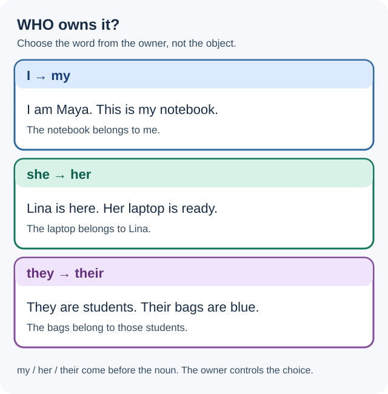

# Elementary 1C — What's your email?

**Elementary · Unit 1C** · **A1 learning orientation**

This original lesson develops **possessive adjectives**, **classroom language**, and recognition of **vowel sounds, the alphabet, and sentence stress**. The topic sequence follows *English File Elementary, Fourth Edition*. The explanations, examples, practice activities and diagram are original.

!!! info "Study route"
    **Grammar: four short steps → Classroom vocabulary → Everyday English → Grammar practice → Vocabulary practice → Guided, controlled and independent Writing → Interactive tutor activities → Quick reference.** Each step has an immediate check. Take the study pauses whenever useful.

## 1. Learning outcomes and preparation

By the end of the lesson, you should be able to:

1. **Choose** *my, your, his, her, its, our,* or *their* according to the **owner**, not the object.
2. **Use** a possessive adjective **before a noun** to identify a person, object or contact detail.
3. **Distinguish** *your/you're*, *its/it's* and *their/they're* in short sentences.
4. **Recognize and use** familiar classroom instructions and polite requests as fixed expressions.
5. **Write** a short original classroom conversation, spelling a fictional email address or name safely.
6. **Practise** listening to spelled letters and basic class instructions, speaking in short exchanges, and recognizing vowel sounds and sentence stress with the interactive tutor.

**Before you begin:** In [1A — Welcome to the class](lesson_a.md) you learned subject pronouns and affirmative *be*. In [1B — One world](lesson_b.md) you learned simple *be* questions, negatives and short answers. You will use both here.

## 2. Grammar learning path — possessive adjectives

### Step 1 — What does a possessive adjective tell us?

#### Understand / Comprender

**English:** A **possessive adjective** tells us **whose** person, object or information we are talking about. It usually comes **immediately before a noun**: *my book, her name, their classroom*. First find the **owner**; then choose the possessive adjective.

**Español:** Los **adjetivos posesivos** indican a quién pertenece o con quién se relaciona algo. Se colocan **antes del sustantivo**: *my notebook* (mi cuaderno), *her name* (su nombre, de ella). La elección depende del **poseedor**, no del género del objeto.

#### Examples — subject and owner

| Subject (1A) | Possessive adjective | English example | Spanish guide |
|---|---|---|---|
| I | **my** | My notebook is here. | mi |
| you | **your** | Your name is Ana. | tu / su / vuestro |
| he | **his** | His phone is blue. | su (de él) |
| she | **her** | Her bag is new. | su (de ella) |
| it | **its** | The school is new. Its name is Oak School. | su (de una cosa/entidad) |
| we | **our** | Our classroom is ready. | nuestro/a |
| they | **their** | Their teacher is here. | su (de ellos/ellas) |

The English possessive adjective **does not change** when the object changes: **my bag / my bags**; **her notebook / her notebooks**. It changes when the **owner** changes: *Leo → his notebook*; *Mia → her notebook*; *Leo and Mia → their notebooks*.

*Visual reminder:* Find the owner first. Then put the matching adjective before the noun.

#### Check your understanding

**A.** A notebook belongs to **me**. Choose: *my / their* notebook.  
**B.** Two students have bags. Choose: *his / their* bags.  
**C.** What comes first: *notebook my* or *my notebook*?

??? note "Check — Step 1"

    **A. My notebook.** The owner is **I**.  
    **B. Their bags.** The owners are **they**.  
    **C. My notebook.** In this pattern the adjective comes **before** the noun.

**Continue when:** you can explain why *her bags* still uses *her* even if there are many bags.

### Step 2 — Choose the adjective from the owner

#### Understand / Comprender

**English:** Ask **Who is the owner?** The owner can be a person, a group or sometimes an organization. Choose the form that matches **that owner**, then place it before the thing or information.

**Español:** En español decimos *su* en situaciones muy diferentes. En inglés normalmente diferenciamos **his** (de él), **her** (de ella), **its** (de una cosa o entidad) y **their** (de ellos, ellas o una persona que usa *they*).

#### Examples — contrast the owners

| Owner | Correct | Why? |
|---|---|---|
| Leo | **His** email address is on the card. | Leo → he → his |
| Sara | **Her** email address is on the card. | Sara → she → her |
| Leo and Sara | **Their** email addresses are on the cards. | two people → they → their |
| You and I | **Our** classroom is Room 5. | we → our |
| The school | **Its** website is useful. | an institution as a singular entity → its |

**Singular *they*:** If someone uses **they** or their gender is not known, **their** is natural even for one person: *Alex is here. Their notebook is on the desk.* This does not mean that the notebook is plural.

**His / her are about the person, not the object.** A Spanish-speaking learner might say *his bag* because *bolso* is masculine in Spanish. In English, the bag has no grammatical gender: **her bag** means the bag belongs to a person referred to as *she*.

**Its** is typically for things, animals when referred to as *it*, and organizations: *The school has a name. Its name is Oak School.* For a person, use their appropriate personal pronoun and possessive adjective.

#### Check your understanding

**A.** Sofia is a student. ___ teacher is here.  
**B.** We are in class. ___ notebooks are ready.  
**C.** A laptop has a screen. ___ screen is large.

??? note "Check — Step 2"

    **A. Her** — Sofia → she → her.  
    **B. Our** — we → our.  
    **C. Its** — the laptop is *it*; its screen belongs to it. No apostrophe.

**Continue when:** you can correctly select *his / her / its / our / their* from the owner.

### Step 3 — Put the adjective in the right place

#### Understand / Comprender

**English:** A possessive adjective goes **before a noun**: *your name*, *our class*, *their books*. It **doesn't stand alone** in the examples taught here. To form a complete statement, use the sentence patterns from 1A and 1B.

**Español:** *My, your, his, her, its, our, their* acompañan a un **sustantivo**. Por ejemplo, *This is her bag*; no digas *This is her* si quieres decir «este es su bolso». (La oración *This is her* puede significar otra cosa: «ella es esta persona», cuando *her* funciona como pronombre objeto).

#### Examples — build complete sentences

| Part 1 | Possessive + noun | Complete original sentence |
|---|---|---|
| This is | **my** book | This is my book. |
| This is | **your** chair | This is your chair. |
| This is | **his** notebook | This is his notebook. |
| That is | **her** laptop | That is her laptop. |
| These are | **our** bags | These are our bags. |

*This is*, *That is* and *These are* are **useful classroom phrases to recognize**. This lesson does not require mastering the full grammar of demonstratives.

**Do not add an article before a possessive adjective in a simple noun phrase:** **my book**, not *the my book* or *a my book*. Compare **a book** (an unspecified book) with **my book** (a book related to me).

**One owner, many things:** *Her books are here.* The adjective stays *her*; *books* and the verb *are* show that the things are plural.

**A beginner-friendly technology example:** *Our laptop is in Room 3.* This is everyday English in a classroom context; technology knowledge is not needed.

#### Check your understanding

**A.** Correct: *the our teacher*.  
**B.** Choose: *My books is here* / *My books are here*.  
**C.** Put in order: *name / your / is / on the card.*

??? note "Check — Step 3"

    **A. Our teacher** — no article before *our* in this noun phrase.  
    **B. My books are here.** The adjective *my* stays the same, but the plural subject *books* takes **are**.  
    **C. Your name is on the card.** *Your* comes before *name*; the whole noun phrase is the subject.

**Continue when:** you can build a short complete sentence, not just select a word from a table.

### Step 4 — Avoid confusing look-alike words

#### Understand / Comprender

**English:** Some common contractions **sound like** possessive adjectives, but they are not the same. Look at the word's **job in the sentence**.

**Español:** *You're* significa **you are**; *your* significa **tu/su**. *It's* significa **it is**; *its* indica posesión. *They're* significa **they are**; *their* significa **su/sus**.

#### Examples

| Possessive adjective | Contraction | Meaning |
|---|---|---|
| **Your** book is here. | **You're** here. | your = belongs to you; you're = you are |
| **Its** name is Oak School. | **It's** a school. | its = belonging to it; it's = it is |
| **Their** class is ready. | **They're** ready. | their = belonging to them; they're = they are |

**How to check:** Replace the word with the full form *you are*, *it is* or *they are*. If it fits, use the **contraction**. If you need a word before a noun to show whose thing it is, use the **possessive adjective**.

- *You're bag* is incorrect: *You are bag* makes no sense here → **your bag**.
- *Its Monday* is incorrect when you mean *It is Monday* → **It's Monday**.
- *Their students* means “the students associated with them.” *They're students* means **They are students**.

**His** is a possessive adjective in *his notebook*. **He's** means *he is* (or sometimes *he has* in later grammar); today use it as **he is** in the familiar 1A pattern.

#### Check your understanding

**A.** ___ a student. (*Your / You're*)  
**B.** ___ classroom is Room 6. (*Our / We're*)  
**C.** ___ bags are blue. (*Their / They're*)

??? note "Check — Step 4"

    **A. You're** — *You are a student.*  
    **B. Our** — the word modifies *classroom*.  
    **C. Their** — it identifies whose bags they are.

!!! success "Study pause 1 — grammar recall"
    Without looking, say the seven possessive adjectives and one example with *his*, *her* or *their*. Explain one difference between *your* and *you're*. Review just the step you find difficult, then continue.

## 3. Vocabulary — classroom language

Classroom language includes **things you see**, **instructions you hear**, and **simple responses**. Many instructions use the **imperative** (the base verb, often without an expressed subject). Treat them as useful **fixed classroom expressions** for now; a full grammar lesson on imperatives comes later.

### 3.1 Useful objects and people

| English | Spanish | In a short sentence |
|---|---|---|
| teacher | profesor/a | Our teacher is here. |
| student / classmate | estudiante / compañero/a | She's a student. |
| classroom | salón / aula | Our classroom is ready. |
| desk | pupitre / escritorio | Her notebook is on the desk. |
| chair | silla | This is his chair. |
| board | tablero / pizarra | The board is white. |
| book / notebook | libro / cuaderno | Your book is here. |
| pen / pencil | bolígrafo / lápiz | My pen is blue. |
| page | página | Page nine is here. |
| email address | dirección de correo | Your email address is on the form. |

*On the desk*, *on the form* and *page nine* are natural chunks for recognition. Detailed preposition and imperative grammar is **not** required today.

### 3.2 Useful classroom instructions

| Teacher says… | Meaning / action |
|---|---|
| Listen. | Escucha. |
| Repeat, please. | Repite, por favor. |
| Open your book. | Abre tu libro. |
| Close your book. | Cierra tu libro. |
| Look at the board. | Mira el tablero. |
| Read the sentence. | Lee la oración. |
| Write your name. | Escribe tu nombre. |
| Spell your name. | Deletrea tu nombre. |
| Work in pairs. | Trabajen en parejas. |
| Check your answers. | Revisa tus respuestas. |

These are **expressions to recognize and use** in class. *Your* is the possessive adjective in *your book*, *your name* and *your answers*.

### 3.3 Asking for help politely

Useful original examples:

> **Teacher:** Open your book, please.  
> **Student:** Sorry?  
> **Teacher:** Open your book.  
> **Student:** Thank you.

> **Student:** How do you spell that, please?  
> **Teacher:** B-O-O-K.  
> **Student:** Thank you.

*How do you spell that?*, *Can you repeat that, please?* and *What does that mean?* are useful **fixed chunks**. Their *do* or *can* structures are not analysed in this lesson.

**Quick check:** Which instruction means “deletrea tu nombre”? Which object is used for writing: *a pencil* or *a chair*?

??? note "Classroom language — check"

    **Spell your name.** means “deletrea tu nombre.” A **pencil** is used for writing; a chair is used for sitting.

## 4. Everyday English — spelling an email address

An **email address** is a piece of contact information, for example **mila27@example.com**. The example is fictional; do not share your real personal address in a public practice activity.

| Symbol | Common spoken form | Fictional example |
|---|---|---|
| @ | at | mila **at** example dot com |
| . | dot | example **dot** com |
| _ | underscore | mila **underscore** lee |
| - | hyphen / dash | class **dash** 5 |
| Letters | letter names | M-I-L-A |

An email address usually has **a name or label + @ + a domain**. For this lesson, practise reading it aloud or spelling a **fictional** one; you do not need to explain how email technology works.

**A short original dialogue:**

> **A:** What's your email address?  
> **B:** It's mila27@example.com.  
> **A:** Sorry, how do you spell Mila?  
> **B:** M-I-L-A.  
> **A:** Thank you.

*What's* means **what is**. *How do you spell…?* is a fixed classroom phrase. We are not adding a new grammar requirement about *do*-questions.

**Personal information note:** You can use invented names and addresses for every exercise. There is no reason to provide a real email address, phone number or password.

!!! success "Study pause 2 — vocabulary and symbols"
    Recall five classroom objects, three classroom instructions and the spoken forms of **@** and **.**. Continue with exercises in this session or return later.

## 5. Ungraded grammar practice — 20 original exercises

**Instructions:** Answer before opening the solution panel. For 1–5, write only the missing word. For the remaining items, follow each specific instruction and write complete sentences where requested. These are **self-study activities, not formal evaluations**.

### Stage A — Identify the owner (1–5)

Choose the correct possessive adjective.

1. I am Maya. This is ___ notebook. (*my / her*)
2. You are in class. Is this ___ chair? (*your / his*)
3. He is Leo. ___ pencil is blue. (*his / our*)
4. We are students. ___ teacher is here. (*our / their*)
5. They are classmates. ___ books are on the desk. (*their / my*)

### Stage B — Build the phrase or sentence (6–10)

Follow the instruction exactly.

6. Replace *Marta's* with a possessive adjective: **Marta's bag is red.** (Use *she*.)
7. Rewrite using a possessive adjective for two owners: **Leo and Nina have a classroom. The classroom is ready.** Begin with *Their…*
8. Correct the word order: **This is notebook my.**
9. Write a complete sentence from these words: **your / is / email address / on the form**.
10. Complete using a word for an institution: **The school is new. ___ classroom is large.**

### Stage C — Spot and explain an error (11–15)

Each line has **one main error**. Rewrite the whole sentence correctly.

11. *You're notebook is on the desk.*
12. *Their in Room 7.*
13. *Its a blue laptop.*
14. *This is the my book.*
15. *She is here. His notebook is blue.* (The notebook belongs to **her**.)

### Stage D — New contexts and combined knowledge (16–20)

16. **Two classmates:** *Leo and Mira are here. ___ teacher is Nora.* Complete with a possessive adjective and explain who the owners are.
17. **Email information:** Correct both errors in this sentence: *You're email address are on the form.*
18. **An English class:** Write **two connected sentences** using *we* and *our*: First say that you and another learner are students; then say that the classroom is ready.
19. **A fictional student:** Complete a short introduction, using *she* or *her* in each blank: **This is Mia. ___ is a student. ___ book is new.**
20. **Classroom help:** Write a **two-turn original exchange** between classmates with fictional names. Include a polite classroom expression, a possessive adjective and either one *be* question from 1B or a fixed classroom question from section 3.

??? note "Grammar answer key — reasons and alternatives"

    | # | Expected answer | Reason |
    |---:|---|---|
    | 1 | **my** | Speaker = *I*, so *my*. |
    | 2 | **your** | The person addressed = *you*, so *your*. |
    | 3 | **His** | *Leo → he → his*; capitalize at the start. |
    | 4 | **Our** | *We → our*; capitalize at the start. |
    | 5 | **Their** | The owners are *they*. |
    | 6 | **Her bag is red.** | Marta is referred to as *she*; the adjective is *her*. |
    | 7 | **Their classroom is ready.** | Leo and Nina are two owners → *their*. |
    | 8 | **This is my notebook.** | Put *my* before the noun *notebook*. |
    | 9 | **Your email address is on the form.** | *Your* modifies *email address*, which is the singular subject of *is*. |
    | 10 | **Its** | *The school* is an institution referred to as *it*. |
    | 11 | **Your notebook is on the desk.** | *You're* means *you are*, but the noun needs *your*. |
    | 12 | **They're in Room 7.** | *They are* is the intended statement. |
    | 13 | **It's a blue laptop.** | Here *it is* is required; use an apostrophe. |
    | 14 | **This is my book.** | An article does not go before *my* in this noun phrase. |
    | 15 | **She is here. Her notebook is blue.** | The owner is *she*, so *her*. |
    | 16 | **Their** | Leo and Mira are two people → *they → their*. |
    | 17 | **Your email address is on the form.** | *You're → Your* because the word modifies a noun; singular *email address* takes **is**, not *are*. |
    | 18 | **We are students. Our classroom is ready.** | *We* names the group; *our* modifies *classroom*. |
    | 19 | **She; Her** | *She* is the subject of the first sentence; *her* modifies *book*. |
    | 20 | **Mia: Is this your pencil, Leo? Leo: Yes, it is. Thank you.** | *Your* modifies *pencil* and points to the listener, Leo. The question places *is* before *this*; *Yes, it is* is the positive short answer. *Thank you* is a polite classroom expression. |

    **Alternatives:** In **6**, a person who uses *they* would have *their bag*, but the prompt explicitly asks you to use *she*. In **7**, *Their classroom is ready* is the required form, while *Leo and Nina's classroom is ready* can express the same relationship using a different construction. In **9**, *Your email address is on the form* is the intended order. In **18**, *We're students. Our classroom is ready* is equally natural. In **20**, many two-turn dialogues are valid when they include names, a possessive and a polite expression. For example: *Nina: Is this your notebook, Omar? Omar: Yes, it is. Thanks.* A fixed question such as *How do you spell your name?* is also acceptable, even though its *do* pattern is not being taught as new grammar. Avoid requiring new tenses.

    **Error diagnosis:** Was the problem **owner selection**, **subject vs possessive**, **word order**, **apostrophe**, **article**, or **be agreement**? Make one new sentence to practise your error.

## 6. Vocabulary and spelling practice — ungraded

**A. Classroom words:** Complete with *book*, *board*, or *pencil*: (1) Write with a ___. (2) Look at the ___. (3) Open your ___.

**B. Classroom language:** Choose the phrase that fits: (1) You do not hear the teacher. Say *Sorry?* or *Good night.* (2) You want someone to spell a word. Use *How do you spell that?* or *Where are you from?*

**C. Fictional email practice:** Read **sam4@example.com** aloud using *at* and *dot*. Spell *Sam* letter by letter.

??? note "Vocabulary and spelling answers"

    **A:** 1. pencil; 2. board; 3. book.  
    **B:** 1. Sorry?; 2. How do you spell that?  
    **C:** *sam four at example dot com*; *S-A-M*. These are practice pronunciations for a fictional address, not personal contact information.

## 7. Writing — guided, controlled and independent

Writing tasks use familiar classroom words and the grammar from 1A–1C. Work through each stage in order.

### Stage 1 — Guided writing

Complete the short sentences. The owner appears in parentheses.

- **A.** ___ pencil is red. (*I*)
- **B.** ___ book is here. (*she*)
- **C.** ___ classroom is ready. (*we*)

??? note "Guided writing — answers"

    **A. My**, **B. Her**, **C. Our**. Find the owner, choose its adjective, put it before the noun.

### Stage 2 — Controlled writing

Adapt each sentence to the **new owner's perspective**. The person speaking or being addressed can change, so keep the situation consistent rather than replacing words mechanically.

- **A.** *His notebook is new.* → the owner is **Mia** (she).
- **B.** *My name is Sam.* → imagine **Sam is now the person you are speaking to**. Tell Sam their name using **your**.
- **C.** *Their classroom is ready.* → the owner is **we**.

??? note "Controlled writing — answers"

    **A. Her notebook is new.**  
    **B. Your name is Sam.** In the original, Sam says **My name is Sam** about themself. In the new situation, **you speak to Sam**, so the same person is addressed as **you** and the possessive changes to **your**. This is a change of speaker perspective, not just a word swap.  
    **C. Our classroom is ready.** The object does not control the adjective.

### Stage 3 — Independent writing

Write a **four- to six-line original conversation** between two classmates. Use **fictional people and contact details**.

Include a greeting, one classroom object with a possessive adjective, a classroom-help expression, and a fictional email address or a spelled fictional first name.

**Original model (make your own):**

> **A:** Hi. I'm Nell.  
> **B:** Hello, Nell. Is this your book?  
> **A:** Yes, it is. Thank you.  
> **B:** How do you spell your name?  
> **A:** N-E-L-L.

**Self-check:** Do the possessive adjectives match the owners? Are they before nouns? Are *your* and *you're* used correctly? Are questions punctuated? Are the examples fictional? Does your dialogue use at least one classroom expression?

??? note "Writing — possible variations"

    Many answers are valid. You can write *Is this her notebook?* if the notebook belongs to a person referred to as *she*. You can use *Can you repeat that, please?* as a **fixed expression**, without needing to analyse the modal verb. There is no formal grade or single required dialogue.

!!! success "Study pause 3 — from practice to speaking"
    Check your own Writing against the list and revisit one difficult grammar step. Listening, Speaking and Pronunciation take place with your tutor, so you can return for that practice in another session.

## 8. Tutor handoff — Listening, Speaking and Pronunciation

These are clear practice prompts for the **English Learning Program interactive tutor**, not tests or scores. Begin slowly and clearly; increase speed only after the learner demonstrates comprehension. Use repeat → slower → rephrase → brief Spanish support if needed.

### Listening — classroom instructions and spelling

**Observable outcome:** Identify at least three familiar classroom instructions and recover a fictional spelled name or email detail.

**Tutor sequence:** (1) Give one simple instruction such as *Open your book*; check meaning without displaying the transcript. (2) Give two different instructions. (3) Spell a fictional first name slowly; learner repeats the letters. (4) Read a short fictional email address with *at* and *dot*; learner identifies the structure. Rephrase and slow down when necessary.

### Speaking — identifying belongings and asking for help

**Observable outcome:** Produce three short sentences with different possessive adjectives and make at least one appropriate classroom request.

**Tutor sequence:** (1) Introduce fictional owners and objects; learner says *This is her notebook* or *Their bags are here*. (2) Ask who an object belongs to; learner chooses *my/your/his/her/our/their*. (3) Practise a class-help fixed expression, such as *How do you spell that, please?* (4) Learner creates a short classroom dialogue. Focus on meaning and two or three high-value corrections.

### Pronunciation — alphabet, vowel sounds and sentence stress

**Observable outcome:** Spell a fictional name intelligibly, recognize selected vowel differences in letter names or familiar words, and identify the emphasized information word in a short sentence.

**Tutor sequence:** (1) Model the alphabet in short groups rather than a long rapid recital; contrast commonly confused letter names (for example **A/E**, **G/J** and **M/N**) without relying on IPA charts. (2) Practise a fictional name slowly, then in a natural exchange. (3) Contrast familiar vowel sounds in a few beginner-level words and confirm by listening, not only automatic transcription. (4) Model different sentence emphasis: *This is MY book* versus *This is my BOOK*. Ask what information becomes important. Do not treat an accent difference as an error when intelligibility is maintained.

**Privacy and assessment:** Do not ask for real private contact details. Do not save personal grades, audio, transcripts or invented results in the public repository. Formal assessment stays in the private learning project.

## 9. Quick reference — Elementary Unit 1

| Topic | Pattern | Short example |
|---|---|---|
| 1A: affirmative *be* | I am / she is / they are | We're students. |
| 1B: negative *be* | subject + be + not | She isn't here. |
| 1B: *be* question | Be + subject + ...? | Are you ready? |
| 1C: possessives | owner → possessive + noun | Her book is here. |
| Seven possessive adjectives | my, your, his, her, its, our, their | Their teacher is here. |
| Most common spelling traps | your ≠ you're; its ≠ it's; their ≠ they're | Your name is Sam. |
| Classroom phrases | Open your book. / Spell your name. | Repeat, please. |
| Symbols | @ = at; . = dot | name at example dot com |

**A short Unit 1 review:** Introduce yourself using *I'm…*; make a negative with *be*; ask someone *Are you from…?*; then identify a classroom object using *his, her, our* or *their*. These are practice prompts, not official test items.

**Keep learning:** [Elementary overview](../index.md) · [1A — Welcome to the class](lesson_a.md) · [1B — One world](lesson_b.md).

---

**About this lesson:** The topic sequence follows *English File Elementary, Fourth Edition*. All teaching explanations, dialogues, exercises and the diagram are original to this learning program. The A1 learning orientation is not a formal CEFR certification.
